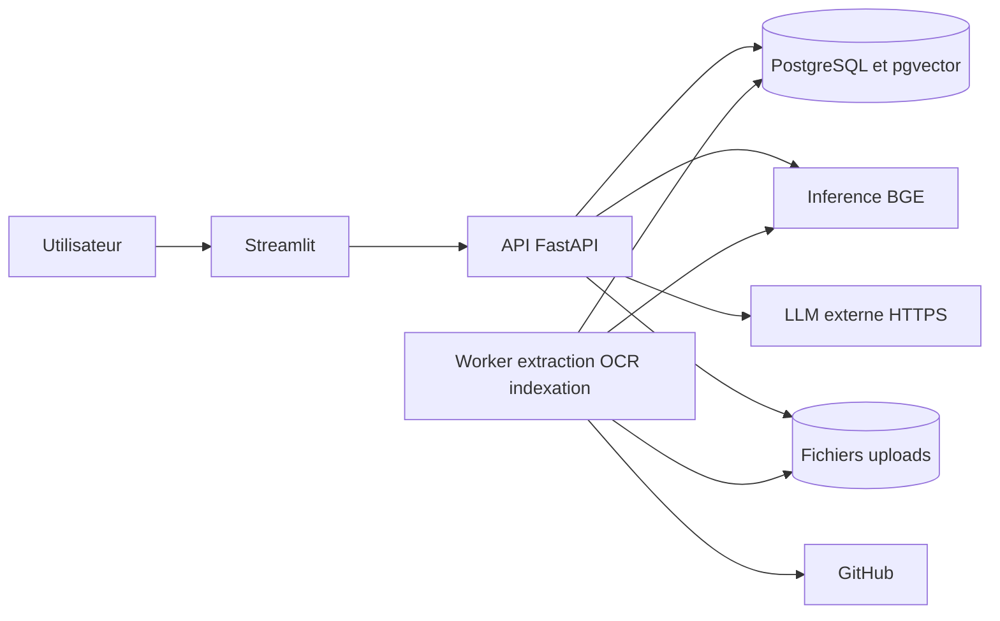

# Doc Code RAG

Assistant IA pour interroger en langage naturel des documents et des dépôts GitHub, avec réponses sourcées, OCR local et contrôle des accès par rôle.

La recherche fonctionne localement avec BGE et PostgreSQL/pgvector. La rédaction est confiée à un **LLM externe configurable dans l’interface**. Les questions sont indépendantes, sans mémoire conversationnelle persistante.

## Fonctionnalités

- Import de PDF, DOCX, Markdown, TXT et images PNG/JPG/JPEG, jusqu’à 20 Mio par fichier.
- OCR français/anglais des images et des pages PDF sans texte sélectionnable.
- Import de dépôts GitHub publics ou privés, avec références aux fichiers et lignes.
- Recherche hybride, fusion RRF et reranking des passages.
- Réponses accompagnées d’extraits sources et abstention lorsque les informations sont insuffisantes.
- Collections et permissions de lecture/écriture par rôle : admin, manager et developer.
- Configuration persistante du fournisseur, de l’URL, du modèle et de la clé API chiffrée.

## Architecture



| Service | Responsabilité |
| --- | --- |
| frontend | Connexion, documents, questions et administration |
| api | Authentification, autorisations, recherche, génération et citations |
| worker | Tâches SQL, extraction, OCR et indexation |
| inference | BGE-M3 et bge-reranker-v2-m3 chargés avec PyTorch |
| postgres | Utilisateurs, droits, documents, passages, vecteurs et configuration |

Trois volumes conservent la base, les fichiers déposés et les modèles. PostgreSQL et l’inférence ne sont pas publiés sur l’hôte. L’interface et l’API sont liées à 127.0.0.1.

## Organisation

```text
backend/
  app/
    api/          Routes HTTP et contrôles d’accès
    core/         Configuration, transactions et initialisation
    ingestion/    Parseurs, OCR, GitHub, découpage et worker
    retrieval/    Recherche, permissions et reranking
    generation/   Fournisseur LLM, prompt et citations
  tests/          Tests unitaires et d’intégration
frontend/         Interface Streamlit
inference/        Service local d’embeddings et de classement
migrations/       Migrations SQL additives
scripts/          Installation, administration et vérification
eval/             Corpus synthétique et protocole d’évaluation
schema.sql        Schéma initial, index et RLS
docker-compose*.yml
.env.example      Variables documentées sans secrets
```

## Prérequis

- Docker Desktop en mode conteneurs Linux et Docker Compose.
- Python 3.12 pour les scripts d’installation, qui utilisent la bibliothèque standard.
- Internet pour construire les images, télécharger les modèles et appeler le fournisseur.
- Une clé API pour un LLM compatible Chat Completions.

Prévoir environ **4,5 Go pour les poids BGE**, plus les images Docker, caches et documents. Le profil CPU fonctionne sans GPU NVIDIA mais peut être lent. Avec 16 Go de RAM, limiter les charges concurrentes et évaluer le corpus cible ; aucune latence garantie n’est annoncée.

## Installation

```shell
git clone https://github.com/Yassine-Ben-Terras/doc-code-rag.git
cd doc-code-rag
python scripts/configure.py
docker compose build api worker frontend
python scripts/download-models.py
docker compose up -d --wait postgres
python scripts/migrate.py
python scripts/bootstrap-admin.py
docker compose up -d
```

Le script configure.py crée `.env` avec des secrets aléatoires. Consulter ce fichier localement pour connaître ADMIN_EMAIL et ADMIN_PASSWORD. Sur une installation existante, les identifiants et la clé de chiffrement sont conservés. Ne jamais publier `.env`.

**Attendre le message `Modèles disponibles` avant de démarrer l’inférence.** Si l’image existe déjà, reprendre uniquement le téléchargement :

```shell
python scripts/download-models.py --skip-build
docker compose ps
docker compose logs --tail=50 inference
```

Le message `Local retrieval models ready` confirme le chargement des deux modèles.

- Interface : <http://localhost:8501>
- Documentation API : <http://localhost:8000/docs>

Si le port 8000 est occupé, définir API_PORT=8002 dans `.env` puis exécuter `docker compose up -d api`. Le frontend reste sur 8501.

### Configurer le LLM externe

Se connecter comme administrateur et ouvrir **Configuration LLM**.

| Champ | Exemple |
| --- | --- |
| Fournisseur | NVIDIA |
| URL de base | https://integrate.api.nvidia.com/v1 |
| Modèle | openai/gpt-oss-20b |
| Clé API | Clé personnelle du fournisseur |

Enregistrer, puis tester la connexion. Le test fait un véritable appel et peut consommer des tokens. La disponibilité et les quotas du modèle dépendent du fournisseur.

Le connecteur utilise `POST <URL>/chat/completions`, Bearer, messages et max_tokens. Il lit le texte dans choices[0].message.content. Le budget est de 4 096 tokens, éventuellement partagé avec le raisonnement selon le modèle. Une réponse finale vide ou tronquée est refusée. Les API natives d’un autre protocole et les entrées multimodales ne sont pas prises en charge.

Une configuration active unique est partagée. Sa clé API est chiffrée avec Fernet en base ; LLM_ENCRYPTION_KEY reste dans `.env`. Laisser le champ clé vide conserve la clé enregistrée si le fournisseur et l’URL restent identiques. Changer l’un des deux exige une nouvelle clé.

## Utilisation

1. Créer une collection depuis Documents.
2. Créer les utilisateurs et attribuer les permissions depuis Administration.
3. Déposer des fichiers ou connecter un dépôt dans une collection vide et dédiée.
4. Attendre ready : `pending → processing → ready / failed`.
5. Poser une question et consulter les passages cités pour vérifier la réponse.

Les droits sont partagés par rôle et collection, pas attribués individuellement à chaque document.

### Dépôts GitHub

Le worker clone la branche par défaut avec profondeur 1, sans tags. Il filtre les extensions et exclut notamment fichiers cachés, liens symboliques, dépendances et certains noms sensibles. Le code est découpé en fenêtres de 60 lignes avec 10 lignes de chevauchement. Il n’est pas exécuté ; les fonctions et dépendances ne sont pas analysées structurellement.

Pour un dépôt privé, renseigner GITHUB_TOKEN dans `.env`, puis recréer le worker. Le jeton passe par GIT_ASKPASS et ne figure pas dans l’URL ou les arguments de clone. Les droits GitHub ne sont pas synchronisés avec les permissions locales.

Limites : 200 Kio par fichier sélectionné, 2 000 fichiers, 20 Mio de fichiers retenus, 10 000 passages et 180 secondes de clonage. Le filtrage intervient après le clone et ne limite pas strictement le transfert Git. Les clones sont temporaires ; aucune actualisation périodique n’est implémentée.

### OCR

Tesseract fra+eng fonctionne localement sur les images déposées et les pages PDF sans texte. La rasterisation est plafonnée à 150 dpi et 3 000 pixels de côté ; le traitement utilise un thread et 120 secondes au maximum par page.

Les images intégrées aux DOCX et aux pages PDF contenant déjà du texte ne sont pas reconnues. Les tableaux Word sont extraits sous forme de texte ; l’OCR ne reconstruit pas les tableaux complexes et n’interprète pas les graphiques. Réimporter les anciens documents est nécessaire pour les retraiter avec un nouveau parseur.

## Recherche et génération

1. Extraction du texte et de la provenance ; découpage documentaire autour de 1 600 caractères avec 200 caractères de chevauchement.
2. Embeddings BGE-M3 de 1 024 dimensions, pgvector/HNSW et index lexical GIN sur tsvector.
3. Filtrage des collections accessibles, puis jusqu’à 30 candidats denses et 30 lexicaux.
4. Fusion Reciprocal Rank Fusion et conservation de 30 candidats uniques. Le moteur lexical utilise PostgreSQL ts_rank, **pas BM25**.
5. Classement bge-reranker-v2-m3, puis conservation des cinq meilleurs passages.
6. Abstention sous le seuil ; sinon appel du LLM et vérification des références citées.

Le seuil initial de 0,5 doit être calibré : il n’est pas une probabilité de confiance. Les citations valides ne garantissent pas le soutien de chaque affirmation. Les synthèses globales peuvent manquer de couverture avec cinq passages. Il n’existe pas de déduplication sémantique ni de budget de contexte dynamique en tokens.

## Configuration et exploitation

Voir [.env.example](.env.example) pour les paramètres.

| Variable | Valeur initiale | Usage |
| --- | --- | --- |
| API_PORT | 8000 | Port publié de l’API |
| RERANK_THRESHOLD | 0.5 | Seuil initial d’abstention |
| CONTEXT_PREFIX | true | Préfixe de section ; nécessite réindexation si modifié |
| INFERENCE_CPU_THREADS | 2 | Threads PyTorch |
| INFERENCE_BATCH_SIZE | 2 | Sous-lots de calcul BGE |
| EMBEDDING_BATCH_SIZE | 4 | Passages par appel du worker |
| EMBEDDING_TIMEOUT | 900 | Attente du worker en secondes |
| RERANK_TIMEOUT | 600 | Attente du classement en secondes |
| CHAT_REQUEST_TIMEOUT | 1020 | Attente du frontend en secondes |
| GITHUB_TOKEN | vide | Accès facultatif aux dépôts privés |

Ces délais tolèrent une machine lente sans accélérer le calcul. Un verrou sérialise embeddings et reranking : une ingestion peut retarder une question.

```shell
# Progression et erreurs
docker compose logs --tail=50 worker

# Mettre à jour le logiciel en conservant les volumes
docker compose build api worker frontend
docker compose up -d --wait postgres
python scripts/migrate.py
docker compose up -d

# Arrêter sans supprimer les volumes
docker compose down
```

L’enregistrement des passages et le statut ready sont transactionnels. Une tâche processing interrompue peut reprendre depuis le début ; les lots intermédiaires ne sont pas persistés. Les tâches failed ne sont pas réessayées automatiquement.

Sauvegarder PostgreSQL, uploads et LLM_ENCRYPTION_KEY, puis tester une restauration. Le volume models peut être retéléchargé. **`docker compose down -v` supprime les volumes** ; une réinstallation Docker peut également les faire perdre.

L’image d’inférence utilise PyTorch CPU. Pour un GPU NVIDIA et son runtime Docker compatible :

```shell
docker compose -f docker-compose.yml -f docker-compose.gpu.yml up -d --build
```

### Dépannage

| Symptôme | Vérification |
| --- | --- |
| Poids BGE introuvables | Terminer download-models.py avant de lancer inference |
| Document en attente | Vérifier worker et santé inference ; consulter les journaux |
| LLM valide mais recherche indisponible | Les embeddings et le reranker sont des services distincts du LLM |
| Réponse incomplète | Examiner les passages sélectionnés et préciser la question |
| Échec pip ou délai réseau | Relancer le build sans --no-cache pour réutiliser les téléchargements |

## Tests

Après construction et configuration, exécuter les tests backend dans leur image :

```shell
docker compose run --rm --no-deps api python -m pytest -q -p no:cacheprovider tests/test_api.py tests/test_pipeline.py tests/test_external_llm.py tests/test_index_readiness.py tests/test_ocr.py
```

Les tests OCR utilisent le vrai Tesseract. Les tests unitaires de génération et de recherche utilisent des doublures et ne mesurent pas la qualité du fournisseur.

Les tests PostgreSQL utilisent un projet Compose distinct et jetable :

```shell
python scripts/test-integration.py --docker
```

Le script supprime uniquement les ressources de documentation-rag-test après exécution. Les contrôles SQL et RLS sont réels ; l’inférence et la génération sont simulées.

Vérification de l’interface dans son image :

```shell
docker compose run --rm --no-deps -v ./scripts:/workspace/scripts:ro -v ./frontend:/workspace/frontend:ro frontend python /workspace/scripts/check-interface.py
```

Le [protocole d’évaluation](eval/README.md) fournit un générateur de corpus **synthétique**, 60 questions, calibration, ablations et métriques. Exécuter `python eval/create_dataset.py` pour créer les données localement ; le corpus généré n’est pas publié. Les exemples adversariaux sont artificiels. Les objectifs de qualité et les gains de temps doivent être mesurés sur le corpus cible avant d’être annoncés.

## Sécurité et limites

- Mots de passe Argon2 et JWT de huit heures ; rôle relu en base.
- Contrôles applicatifs et RLS forcée sur chunks. Le compte API ne contourne pas RLS ; le worker possède une identité SQL privilégiée pour l’indexation.
- Clés API chiffrées ; secrets, uploads, caches et rapports personnels exclus de Git.
- Les documents sont des données non fiables dans le prompt. L’accès est filtré avant génération ; la prompt injection et les hallucinations ne sont pas éliminées avec certitude.
- La question et les extraits retenus sont envoyés au fournisseur externe : vérifier ses règles de confidentialité et de conservation.
- Avant une exposition partagée : HTTPS, limitation de débit, audit, restriction des destinations sortantes et sauvegardes testées.
- Pas de vision multimodale, Excel/CSV, mémoire conversationnelle, graphe d’appels, synchronisation GitHub automatique ou haute disponibilité intégrés.

## Technologies

Python 3.12 · FastAPI · Streamlit · PostgreSQL 17 · pgvector 0.8 · BGE-M3 · bge-reranker-v2-m3 · PyTorch · Tesseract · PyMuPDF · python-docx · Docker Compose · pytest.
